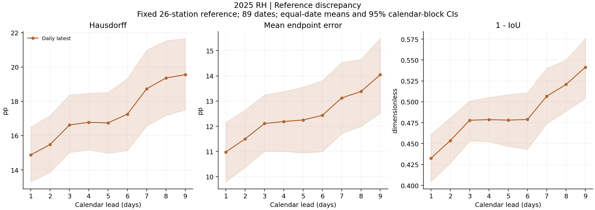

# Task 1(a)：RH metric sensitivity 補充實驗

2026-11-17 HKT。支援 RQ-A／RQ-C，只涵蓋 Task 1(a)。

**三種 metrics 支持相同的整體結論，但個別 revision 的評價明顯受 metric 影響。**
近程 forecast 的 regional-reference discrepancy 較低，近程 revisions 平均較小。
平均 RevisionGain 在兩種 cadence 下均為正。
然而，在真正改動過 RH endpoints 的 updates 中，Hausdorff 與 endpoint 方法只有約61%的日期等權分類 agreement。
因此不能把「平均有改善」寫成「每次改動都改善」，亦不能把「多數改動有改善」當作 metric-invariant 結論。

## 1. 固定資料與 measurement contract

- 固定2025、26站、89個完整 HKT dates。Accuracy 為相同801個 date–lead cases，lead1–9。
- 每站每日要求144個 numeric nominal ten-minute slots。先形成 sampled min–max，再取固定站網 envelope。
- 日界為 `[00:00 HKT, next 00:00 HKT)`。沿用 canonical latest-capture deduplication，沒有補值或放寬 gate。
- Regional observations 使用既有 frozen files。核對原 SHA-256，並由 canonical readings 獨立重建89日 reference。
- Live database 使用 read-mode bridge。保存完整2025 target-date forecast trajectories，共12,884行，沒有 conflicting duplicates。
- 目前 database 未見 regional RH tables；沒有新增或修改 tables。兩次 live SQL queries 各自是 read-only transaction。

這是 **regional-reference discrepancy**，不是 HKO official accuracy。
該 envelope 尚未證明等同 public forecast 的官方 spatial target。
One-minute means 是 nominal ten-minute updates 的 sampled readings，不是完整 minute-by-minute extrema。
詳細定義沿用 [regional measurement contract](https://github.com/JJChand/COMP3522/blob/main/analyses/05_rq4_accuracy_by_lead/REGIONAL_RH_METHOD.md)。

## 2. 比較方法

令 `F=[Lf,Uf]`、`O=[Lo,Uo]`。三種 loss 均愈低愈好。

| Metric | 計算 | 單位／解讀 |
| --- | --- | --- |
| Hausdorff | `max(abs(Lf-Lo), abs(Uf-Uo))` | pp；最差 endpoint |
| Mean endpoint absolute error | `(abs(Lf-Lo)+abs(Uf-Uo))/2` | pp；兩端平均 |
| Overlap loss | `1 − intersection_length/union_length` | 無量綱；range overlap |

IoU 在相同 zero-width ranges 設為1；其他零長度 intersection 設為0。
Disjoint ranges 的 overlap loss 均為1，無法區分相距多遠。
IoU 亦受 range width 影響，故不能直接與 pp losses 比分數大小。
三種 metrics 均保留相同 observations、forecast IDs、timestamps 與 denominators。
另輸出 signed endpoint errors、center bias 及 width bias。

HKO API 定義為 minimum／maximum RH，沒有 nominal probability coverage。
因此沒有使用 probabilistic interval score，也沒有選 acceptable-error threshold。
Sources：[HKO API fields](https://data.weather.gov.hk/weatherAPI/doc/HKO_Open_Data_API_Documentation.pdf)、[IoU geometry and limits](https://giou.stanford.edu/)。本輪核對日期：2026-11-17。

## 3. 整體結論的 consistency

以下為日期等權 estimates，brackets 是95% calendar-block CI。
Near-minus-far 為負，表示近程較小。RevisionGain 為正，表示平均改善。

| 預定比較 | Hausdorff（pp） | Endpoint（pp） | Overlap loss（無量綱） |
| --- | --- | --- | --- |
| Accuracy：lead1–3 減7–9 | −3.554 [−4.902, −2.216] | −1.987 [−2.840, −1.158] | −0.0683 [−0.0977, −0.0394] |
| Bulletin stability：later lead1–3 減7–8 | −0.312 [−0.553, −0.095] | −0.231 [−0.416, −0.070] | −0.0170 [−0.0286, −0.0064] |
| Bulletin RevisionGain：all pairs | +0.1435 [0.0962, 0.1917] | +0.0941 [0.0640, 0.1229] | +0.00334 [0.00228, 0.00432] |

Daily-latest sensitivity 的方向相同，CI 亦未跨零。
Changed-only mean gains 同樣為正。
共有7個 contrast families ×3 metrics；21個 marginal CIs 均支持上述方向。
這不是21個獨立實驗，亦未作 familywise multiple-testing adjustment。
完整數字見 [paired contrasts](paired_contrasts.csv)。

Accuracy 的整體 means 為17.2647 pp、12.4438 pp及0.4854。
原有 Hausdorff overall 及九個 lead means 均重現。
Accuracy lead ranking 的 Spearman correlations 為0.9833–1.0000。
Hausdorff／overlap 對 lead4與5的次序，與 endpoint 方法稍有不同。
不能由 near/far contrast 推出每縮短一天都必然改善。

## 4. Revision：整體一致，個別判斷敏感

主分析先建立完整 trajectory，再選相鄰 archived bulletins。
要求 gap≤24h、沒有跳過已觀察到的 intervening bulletin，且兩端 leads 均為1–9。
Daily-latest 另要求 consecutive issue dates。
兩種 scopes 都固定相同89個 reference dates；沒有因 metric 改變配對。

| Scope | All pairs | Endpoints 有改動的 pairs | Unchanged |
| --- | ---: | ---: | ---: |
| Adjacent bulletin ≤24h | 2,885 | 317 | 2,568（89.01%） |
| Daily-latest | 712 | 305 | 407（57.16%） |

主分析 lead9 有89對 same-day boundary updates，全部 unchanged。
Daily-latest 沒有 later lead9。它們不納入近／遠程 stability contrast。
圖中將 boundary points 分開標示，避免連線暗示一般 horizon pattern。
Lead1 也不是每個 metric 下最穩定的單一 lead。

`RevisionGain = Loss(old,O) − Loss(new,O)`。
浮點 tie tolerance 為 `1e−10`，不是氣象上的 acceptable-error standard。
每對 revisions 都使用同一個 realized reference。

| Changed-only 比較 | Bulletin 日期等權 agreement | Daily-latest 日期等權 agreement |
| --- | --- | --- |
| Hausdorff vs endpoint | 61.30% [53.88, 68.82] | 61.02% [53.59, 68.65] |
| Hausdorff vs overlap | 61.30% [53.88, 68.82] | 61.02% [53.59, 68.65] |
| Endpoint vs overlap | 99.62% [98.73, 100.00] | 99.62% [98.73, 100.00] |

Pair-weighted Hausdorff／endpoint agreement 分別為62.15%及61.64%。
All-pair agreement 較高，部分原因是大量 unchanged updates。
不能用它掩蓋 changed-only 的分歧。

Bulletin scope 中，Hausdorff／endpoint 在120對 changed updates 有不同分類。
113對涉及 tie，7對是改善／變差方向相反。
Daily-latest 分別為117對分歧、109對涉及 tie、8對相反。
兩個 scopes 的 pairs 有重疊，不可把這些 counts 相加當獨立 cases。
Endpoint／overlap 在每個 scope 也有1對相反判斷。

主分析 changed-only 的日期等權 improved share：

| Metric | Improved | Tied | Worsened |
| --- | ---: | ---: | ---: |
| Hausdorff | 48.93% | 24.67% | 26.39% |
| Endpoint | 56.48% | 13.97% | 29.55% |
| Overlap | 56.86% | 13.97% | 29.17% |

以上是樣本內 point estimates，不是跨時期的 majority guarantee。
正 mean gain 可由改善幅度大於惡化幅度產生，不要求 improved share 超過50%。
相關 rates 的 CI 已輸出在 [usefulness summary](usefulness_summary.csv)。

例子：valid date **2025-11-19**，reference `[26,80]`。
Forecast 由 `[45,65]` 改為 `[55,80]`。
Hausdorff gain＝−10 pp；endpoint gain＝+2.5 pp；overlap gain＝+0.092593。
Lower endpoint 變差，但 upper endpoint 改善。
Hausdorff 的 worst-endpoint 判斷與另外兩種 metrics 因而相反。
Forecast IDs、times及更多例子見 [case ledger](metric_disagreement_examples.csv)。

## 5. Uncertainty、驗證與重跑

- 2,000次 circular seven-calendar-day block bootstrap，seed3522。保留365日 missing mask。
- 同日所有 leads／pairs 一起 resample。每個 contrast 先限制 common dates，再算 paired CI。
- Accuracy 各 lead 日期等權，overall 九 leads 等權。Revision 先同日平均，再日期等權。
- Pair-weighted sensitivity 另列；changed-only 排除沒有改動的日期，因此為88日。
- 不用獨立 marginal CIs 的 overlap 判斷差異。Seven-day block 是既有 exploratory default。

驗證包括：

1. 原始 SHA-256、89日／801 cases、所有 forecast IDs／times／endpoints，以及既有 Hausdorff 結果。
2. 直接由 canonical readings 重建2,314個 station-days及89個 regional envelopes。
3. 由 saved source rows 獨立建立兩種 eligible pair sets，逐對核對3,597個 revision cases。
4. Live SQL 獨立核對9個 accuracy counts及27個 metric means。
5. 獨立重算252列 summaries、21個 contrast estimates／block CIs及108個 agreement matrix cells。
6. 五項 synthetic tests 涵蓋 range geometry、degenerate／非法 endpoints、metric方向反轉、missing bulletin及日期等權。

所有檢查已通過。數字與圖表由 source script 生成，沒有手動改 generated tables。
已執行 offline replay，重跑不需要保持 database 連線。
方法、四組 PNG／SVG、彙總 tables及 receipts 見 [完整發布結果 README](README.md)。
本次 GitHub 發布為 result-only supplement。完整 source scripts、raw snapshots及全量 case tables仍在 companion workspace。
Validation receipts記錄原分析的檢查，不表示此 repo 已包含可獨立重跑的新 pipeline。

## 6. Requirements traceability 與 final wording

| Prescribed requirement | RQ | Evidence | 可支持的結論／限制 |
| --- | --- | --- | --- |
| 1(a) validity／accuracy | RQ-A | Accuracy summaries、near/far CI、rank correlations | 主要 horizon contrast 對三種 metrics 一致；target 仍為 regional proxy |
| 1(a) reliability／fluctuation | RQ-C stability | 兩種 cadence、stability contrasts | 近程 revisions 平均較小；不宣稱逐 lead monotonic |
| 1(a) revision usefulness | RQ-C effectiveness | Gains、all／changed分母、agreement matrices | 平均 benefit 為正；個別分類及「多數改善」措辭對 metric 敏感 |
| Validity／reproducibility | Measurement contract | Hashes、live SQL、獨立驗證 | 固定共同 cases；coverage／spatial mismatch 未被消除 |

建議 final report 表述：

> With the same 2025 regional reference and forecast cases, Hausdorff distance,
> mean endpoint absolute error and overlap loss support lower near-term discrepancy,
> smaller near-term revisions and positive average revision benefit.
> Individual revision classifications remain metric-sensitive, particularly when
> improvement in one endpoint leaves the worst endpoint unchanged or worsens it.

本輪未做 Task1(b) factors、correction model 或新 baseline skill。
結論限於既有2025、89日、26站 sampled reference；不能推廣至官方全港 accuracy、多年 improvement 或 agency ranking。
Historical public availability、archive completeness及 historical sensor eligibility 的限制仍然存在。
