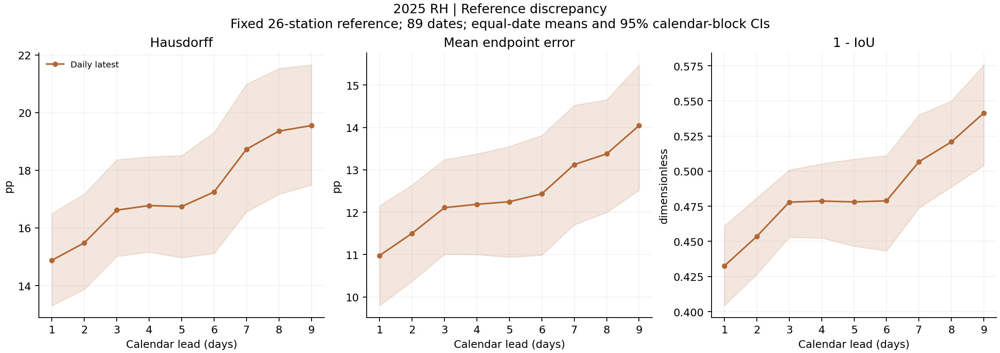
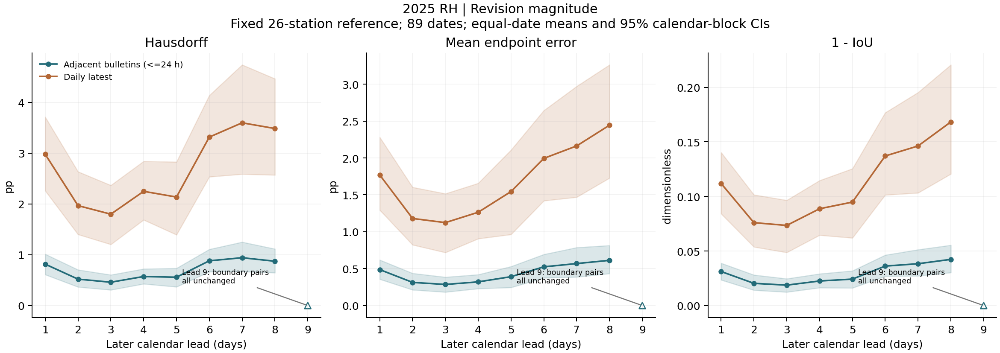
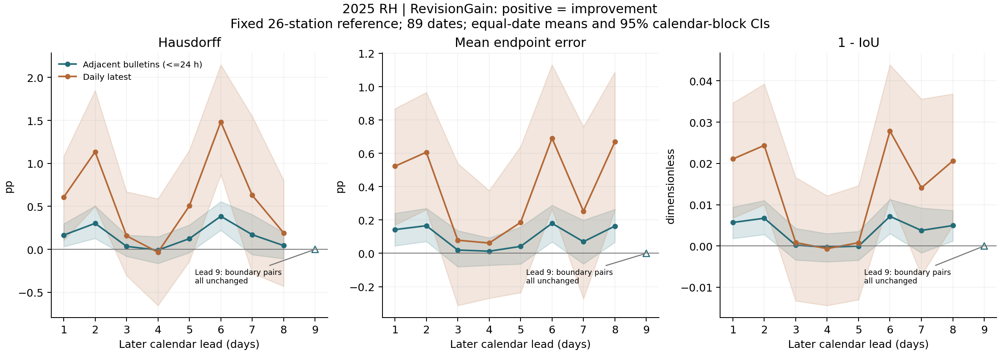
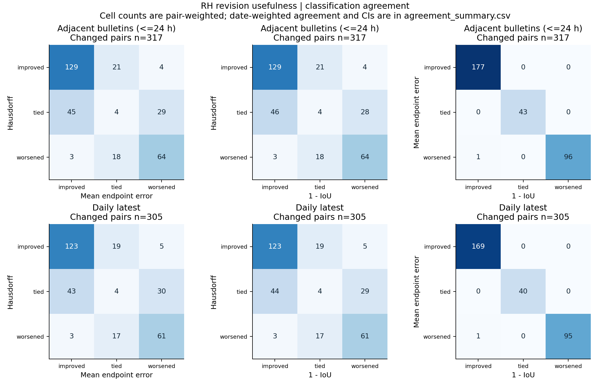

# Task 1(a): RH metric sensitivity, fixed 2025 regional reference

Generated from frozen inputs. Three metrics support the same aggregate directions: lower near-term
reference discrepancy, smaller near-term revisions, and positive average RevisionGain. All 21
preselected contrast/metric 95% CIs exclude zero in these directions. This does not establish
equivalence, strict lead-by-lead monotonicity, or agreement on each individual revision.

This folder publishes results already executed in a companion analysis workspace. It contains
aggregate tables, illustrative revision examples, PNG/SVG figures and validation receipts.
Raw snapshots, full case-level exports, credentials, database identity and workspace-specific
execution scripts are excluded. The existing repository `run_analysis.py` does not reproduce
this supplement. See [the Chinese findings](FINDINGS_ZH.md) for a concise companion account.

## Measurement and data

Use the existing 26-station panel, 89 complete HKT dates and 801 daily-latest date/lead cases.
The valid-day window is [00:00 HKT, next 00:00 HKT). Each station/day requires all 144 numeric
nominal ten-minute slots. Canonical readings use the frozen latest-capture deduplication policy.
First form each station's sampled daily min/max; take the minimum and maximum across the fixed
panel. The source is one-minute means sampled at nominal ten-minute updates, not full-minute extrema.

Regional observations are immutable local inputs, checked against their existing SHA-256 registers.
Forecasts come from one read-only SQL statement, retaining the complete 365-target-date trajectories
before selecting the 89 reference dates. The saved JSON enables offline reruns in the companion workspace; that export is not part of this publication. An independent
read-only SQL statement reproduces all nine accuracy counts and 27 metric means. Neither query
changes the database. The two query transactions do not constitute one atomic snapshot.

The comparison is **regional-reference discrepancy**, not official HKO verification. The public
forecast is not established as a forecast of this exact spatial envelope. No baselines or model
skill estimates were added; results concern sensitivity of an existing comparison definition.

## Metrics

For F=[Lf,Uf], O=[Lo,Uo], all losses are lower-is-better:

- Hausdorff: max(abs(Lf-Lo), abs(Uf-Uo)), in percentage points (pp).
- Mean endpoint error: (abs(Lf-Lo)+abs(Uf-Uo))/2, in pp.
- Overlap loss: 1 - intersection_length/union_length, dimensionless.

Identical zero-width ranges have IoU=1. Other zero-length intersections have IoU=0.
Disjoint ranges all have overlap loss=1. IoU is width-sensitive and does not distinguish
different separation distances once ranges are disjoint. It is a geometric descriptor,
not a probabilistic calibration score. HKO min/max fields provide no nominal probability
coverage. Different metric units must not be subtracted or combined into a total score.
Lower/upper signed errors and center/width biases were retained in the companion case tables.
Their aggregate diagnostics are published here; full case tables remain in the companion workspace.

## Accuracy

| Metric | Unit | Equal-lead mean | 95% CI |
| --- | --- | --- | --- |
| Hausdorff | pp | 17.2647 | [15.5692, 19.0140] |
| Mean endpoint error | pp | 12.4438 | [11.2172, 13.6667] |
| 1 - IoU | dimensionless | 0.4854 | [0.4599, 0.5102] |

The original strict26 Hausdorff mean (17.264669 pp) and all nine published lead means were
reproduced. Near leads 1–3 have lower mean loss than far leads 7–9 under all three metrics.
The overall nine leads have equal weights; each lead uses the same 89 dates.

Lead ranking from lowest to highest mean loss:

- Hausdorff: 1, 2, 3, 5, 4, 6, 7, 8, 9
- Mean endpoint error: 1, 2, 3, 4, 5, 6, 7, 8, 9
- 1 - IoU: 1, 2, 3, 5, 4, 6, 7, 8, 9

Lead-mean Spearman correlations range from 0.9833
to 1.0000. Case-loss correlations are lower;
see [all correlations](metric_rank_correlations.csv). The small rank differences do not reverse
the predefined near/far contrast. No arbitrary correlation cutoff or equivalence margin was adopted.

## Revision stability and usefulness

Primary: adjacent archived bulletins with gap <=24 hours, no skipped observed intervening
bulletin, both leads 1–9. Sensitivity: daily-latest forecasts on consecutive issue dates.
Full trajectories are paired before lead, missing-value, publication-cutoff and reference-date
gates. Missing values are not bridged. Same-day revisions and cross-day revisions remain
identified in [cadence summaries](revision_cadence_summary.csv).

- consecutive_le24h: 2,885 total pairs; 317 changed; 2,568 unchanged (89.01%). Hausdorff/endpoint disagree on 120 changed pairs: 7 opposite directions and 113 involving a tie.
- daily_latest: 712 total pairs; 305 changed; 407 unchanged (57.16%). Hausdorff/endpoint disagree on 117 changed pairs: 8 opposite directions and 109 involving a tie.

Stability compares F_old and F_new using the same three distances. The near/far contrast is
later leads 1–3 minus 7–8, on common dates. Lead9 is structurally absent from daily-latest
pairs. In the primary sample it consists of 89 same-day boundary pairs, all unchanged.
It is displayed for coverage, excluded from near/far contrasts, and not evidence of a smooth
monotone horizon effect. Lead1 is not consistently the most stable individual lead.

RevisionGain = Loss(F_old,O) - Loss(F_new,O), with exactly the same reference for each pair.
All-pair and changed-only mean gains are positive under every metric and both cadence scopes.
A changed pair changes either RH endpoint; it is defined independently of metric. One date
has no changed pair, so changed-only summaries use 88 dates, not 89.

All headline revision statistics first average pairs within each valid date, then average
dates equally. Pair-weighted means/rates are sensitivity columns, not the headline estimand.
Changed-only outcome rates below likewise give dates equal weight:

| Scope | Metric | Improved % | Tied % | Worsened % | Weather dates |
| --- | --- | --- | --- | --- | --- |
| consecutive_le24h | Hausdorff | 48.93 | 24.67 | 26.39 | 88 |
| consecutive_le24h | Mean endpoint error | 56.48 | 13.97 | 29.55 | 88 |
| consecutive_le24h | 1 - IoU | 56.86 | 13.97 | 29.17 | 88 |
| daily_latest | Hausdorff | 48.64 | 25.09 | 26.27 | 88 |
| daily_latest | Mean endpoint error | 56.25 | 13.54 | 30.21 | 88 |
| daily_latest | 1 - IoU | 56.63 | 13.54 | 29.83 | 88 |

Positive average gain does **not** mean a majority of changed updates improve by every metric.
Hausdorff's equal-date improved share is below 50%, while the endpoint and overlap shares exceed
50%. Tie rates differ because a better non-dominant endpoint can leave Hausdorff unchanged.

## Individual revision agreement

| Scope | Metrics | Changed pairs | Equal-date agreement % [95% CI] | Pair-weighted % |
| --- | --- | --- | --- | --- |
| consecutive_le24h | Hausdorff / Mean endpoint error | 317 | 61.30 [53.88, 68.82] | 62.15 |
| consecutive_le24h | Hausdorff / 1 - IoU | 317 | 61.30 [53.88, 68.82] | 62.15 |
| consecutive_le24h | Mean endpoint error / 1 - IoU | 317 | 99.62 [98.73, 100.00] | 99.68 |
| daily_latest | Hausdorff / Mean endpoint error | 305 | 61.02 [53.59, 68.65] | 61.64 |
| daily_latest | Hausdorff / 1 - IoU | 305 | 61.02 [53.59, 68.65] | 61.64 |
| daily_latest | Mean endpoint error / 1 - IoU | 305 | 99.62 [98.73, 100.00] | 99.67 |

High all-pair agreement is partly driven by unchanged updates. Among changed updates,
Hausdorff/endpoint agreement is only about 61% with equal-date weighting. Most disagreements
involve a tie; opposite direction cases also occur. Endpoint and overlap agree in all but one
changed pair per scope in this sample, which does not establish mathematical equivalence.

Example: valid date 2025-11-19; reference [26,80];
forecast [45,65] -> [55,80].
Hausdorff gain=-10 pp, endpoint gain=2.5 pp,
overlap gain=0.092593. The lower endpoint becomes farther from the reference
while the upper endpoint improves enough to reduce average endpoint error and increase overlap.
Thus the metrics answer different questions about this individual revision.
All selected examples retain forecast IDs/timestamps in [the example ledger](metric_disagreement_examples.csv).

## Preselected paired contrasts

Near-minus-far <0 supports lower near-term discrepancy/revision magnitude. Gain >0 supports
average improvement. These are complementary statements, not interchangeable forms of improvement.

| Contrast | Scope | Denominator | Metric | Mean [95% CI] | Dates |
| --- | --- | --- | --- | --- | --- |
| accuracy_near_minus_far | daily_latest | all_pairs | Hausdorff | -3.5543 [-4.9024, -2.2159] | 89 |
| accuracy_near_minus_far | daily_latest | all_pairs | Mean endpoint error | -1.9869 [-2.8396, -1.1581] | 89 |
| accuracy_near_minus_far | daily_latest | all_pairs | 1 - IoU | -0.0683 [-0.0977, -0.0394] | 89 |
| stability_near_minus_far | consecutive_le24h | all_pairs | Hausdorff | -0.3119 [-0.5532, -0.0947] | 89 |
| stability_near_minus_far | consecutive_le24h | all_pairs | Mean endpoint error | -0.2312 [-0.4155, -0.0697] | 89 |
| stability_near_minus_far | consecutive_le24h | all_pairs | 1 - IoU | -0.0170 [-0.0286, -0.0064] | 89 |
| stability_near_minus_far | daily_latest | all_pairs | Hausdorff | -1.2921 [-2.2633, -0.4165] | 89 |
| stability_near_minus_far | daily_latest | all_pairs | Mean endpoint error | -0.9457 [-1.6668, -0.2968] | 89 |
| stability_near_minus_far | daily_latest | all_pairs | 1 - IoU | -0.0702 [-0.1152, -0.0286] | 89 |
| mean_revision_gain | consecutive_le24h | all_pairs | Hausdorff | 0.1435 [0.0962, 0.1917] | 89 |
| mean_revision_gain | consecutive_le24h | all_pairs | Mean endpoint error | 0.0941 [0.0640, 0.1229] | 89 |
| mean_revision_gain | consecutive_le24h | all_pairs | 1 - IoU | 0.0033 [0.0023, 0.0043] | 89 |
| mean_revision_gain | consecutive_le24h | changed_only | Hausdorff | 1.3188 [0.8376, 1.8180] | 88 |
| mean_revision_gain | consecutive_le24h | changed_only | Mean endpoint error | 0.8987 [0.6312, 1.1581] | 88 |
| mean_revision_gain | consecutive_le24h | changed_only | 1 - IoU | 0.0326 [0.0223, 0.0425] | 88 |
| mean_revision_gain | daily_latest | all_pairs | Hausdorff | 0.5843 [0.3926, 0.7783] | 89 |
| mean_revision_gain | daily_latest | all_pairs | Mean endpoint error | 0.3834 [0.2603, 0.5012] | 89 |
| mean_revision_gain | daily_latest | all_pairs | 1 - IoU | 0.0136 [0.0093, 0.0176] | 89 |
| mean_revision_gain | daily_latest | changed_only | Hausdorff | 1.3625 [0.8714, 1.8655] | 88 |
| mean_revision_gain | daily_latest | changed_only | Mean endpoint error | 0.9262 [0.6606, 1.1877] | 88 |
| mean_revision_gain | daily_latest | changed_only | 1 - IoU | 0.0337 [0.0234, 0.0439] | 88 |

Each of the seven contrast families has the same point-estimate sign across metrics and all
three 95% CIs exclude zero. These are exploratory marginal CIs, not a multiple-testing-adjusted
familywise claim. Complete rankings, pair-level classifications and majority-improvement claims
are more sensitive than these aggregate contrasts.

## Uncertainty, validation and limits

- 2,000 circular seven-calendar-day block-bootstrap draws, seed 3522, over all 365 HKT dates.
  The missing-date mask remains in place and all leads/pairs within a date move together.
  Near/far differences use common dates and the same resampling indices. CIs concern means/rates,
  not a range of daily forecast errors. Seven days is the existing exploratory choice, not an
  estimated optimal block length. Empty draws, if any, are omitted and counted; singleton CIs
  are undefined. The selected contrasts all retain 2,000 valid draws.
- Floating-point ties use abs(gain)<=1e-10 only for arithmetic tolerance. No meteorological
  acceptable-error threshold or equivalence margin was chosen.
- The independent verifier reconstructs the 89 regional envelopes from canonical readings,
  independently builds eligible trajectory pairs, recomputes losses/statuses, and checks summary
  statistics, paired-contrast CIs and agreement matrix counts. See [independent receipt](independent_validation.json)
  and [input/SQL/code fingerprints](analysis_validation.json). Synthetic tests cover range geometry,
  degenerate/invalid intervals, ranking reversals, missing-bulletin pairing and date weighting.
- Missing 276 reference dates, seven unacquired station sources and uncertified historical
  sensor eligibility limit representativeness. Bootstrap cannot correct these gaps.
- Bulletin and publication timestamps precede valid-day start. They do not independently
  establish true historical public availability or completeness of the archive.
- 2025 was already explored; this is not an untouched test. No long-term trend, all-Hong-Kong
  official accuracy, agency ranking, factor association, causal or correction-model claim is made.

## Requirements traceability

| Requirement | RQ | Evidence | Final answer / limitation |
| --- | --- | --- | --- |
| Task 1(a) validity / accuracy | RQ-A | accuracy cases, summaries, near/far contrasts, ranks | Aggregate horizon contrast is robust to these metrics; regional-reference target limits remain |
| Task 1(a) reliability / fluctuation | RQ-C stability | bulletin and daily-latest revision summaries | Near revisions are smaller on average; not strictly monotone across individual leads |
| Task 1(a) revision usefulness | RQ-C effectiveness | gains, changed/all denominators, agreement matrices | Mean benefit is positive across metrics; individual classifications and majority-improvement wording are sensitive |
| Reproducibility / validity | measurement contract | hashes, SQL cross-check, synthetic tests, independent receipt | Fixed common cases isolate metric choice; uncertainty does not fix spatial or coverage mismatch |

## Publication and reproducibility boundary

The analysis and its offline replay were executed and verified before publication. The receipts
record those checks and the original input/SQL/code SHA-256 fingerprints; they are records of the
companion run, not executable verification supplied by this result-only update. Reproducing
the complete experiment requires the companion source scripts, frozen regional observations
and saved forecast query response. No public download location for that full bundle is claimed.

This publication adds no database changes. It supplements Task 1(a), with no Task 1(b) factors,
correction model, new baseline skill experiment or official territory-wide verification claim.

Published artifacts:

- [中文摘要](FINDINGS_ZH.md)
- [Accuracy summary](accuracy_summary.csv), [stability summary](stability_summary.csv), [usefulness summary](usefulness_summary.csv)
- [Paired contrasts](paired_contrasts.csv), [agreement matrices](agreement_matrices.csv), [agreement summary](agreement_summary.csv)
- [Rank correlations](metric_rank_correlations.csv), [illustrative revision examples](metric_disagreement_examples.csv)
- [Signed-error diagnostics](endpoint_diagnostics.csv), [monthly reference coverage](coverage_by_month.csv)
- [Revision coverage](revision_coverage.csv), [cadence summaries](revision_cadence_summary.csv)
- [Analysis validation record](analysis_validation.json), [independent validation record](independent_validation.json)
- [Publication manifest](publication_manifest.json): SHA-256 and Git blob hashes for the published package
- [HKO API fields](https://data.weather.gov.hk/weatherAPI/doc/HKO_Open_Data_API_Documentation.pdf),
  [regional measurement contract](../../REGIONAL_RH_METHOD.md),
  [existing revision protocol](../../../02_rq1_revisions/README.md),
  [IoU geometry and limitations](https://giou.stanford.edu/). Context checked 2026-11-17 HKT.

The PNG figures have matching SVG files: [accuracy](accuracy.svg), [stability](stability.svg),
[usefulness](usefulness.svg), [revision agreement](revision_agreement.svg).
