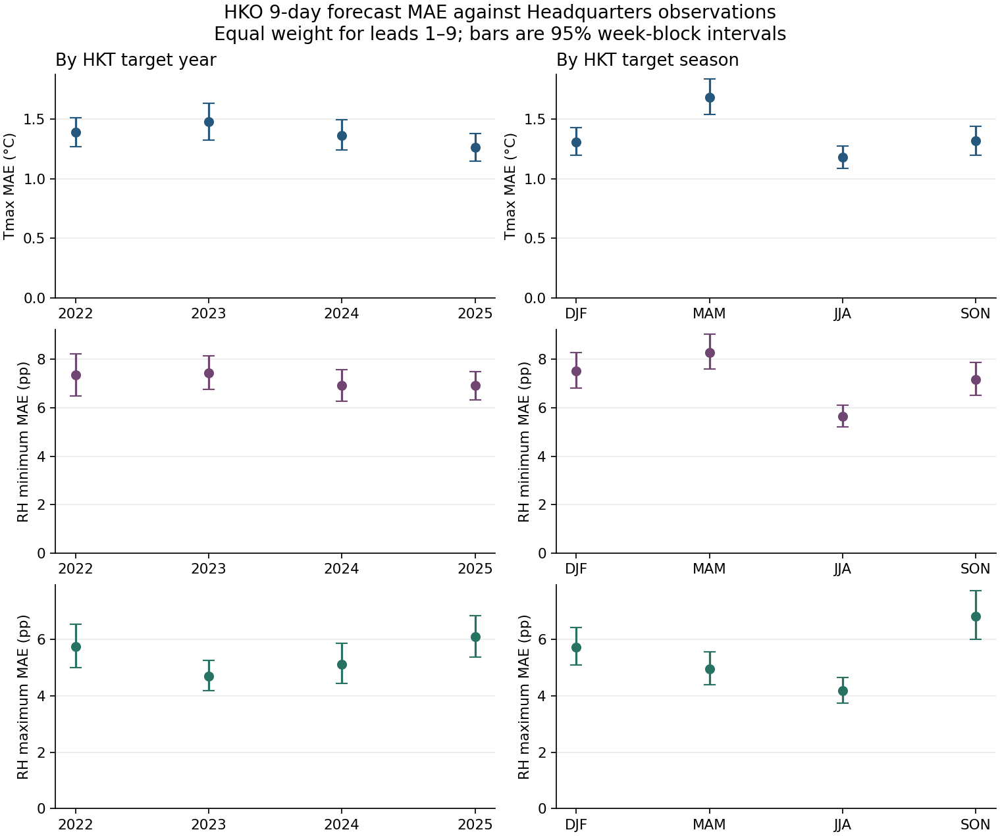

# Tmax and relative humidity MAE by year and season

This supplement to [RQ4 accuracy by lead](../../../05_rq4_accuracy_by_lead/README.md) compares HKO public 9-day forecasts with Hong Kong Observatory Headquarters observations over 2022–2025. It uses the same Tmax, minimum RH and maximum RH forecast–observation pairs as RQ4.



| HKT target year | Tmax (°C) | RH min (pp) | RH max (pp) | Matched / possible cases per metric |
| --- | ---: | ---: | ---: | ---: |
| 2022 | 1.39 | 7.35 | 5.75 | 3,240 / 3,285 |
| 2023 | 1.48 | 7.43 | 4.70 | 3,285 / 3,285 |
| 2024 | 1.36 | 6.90 | 5.13 | 3,293 / 3,294 |
| 2025 | 1.26 | 6.90 | 6.11 | 3,285 / 3,285 |

| HKT target season | Tmax (°C) | RH min (pp) | RH max (pp) | Matched / possible cases per metric |
| --- | ---: | ---: | ---: | ---: |
| DJF (Dec–Feb) | 1.31 | 7.50 | 5.73 | 3,203 / 3,249 |
| MAM (Mar–May) | 1.69 | 8.28 | 4.96 | 3,312 / 3,312 |
| JJA (Jun–Aug) | 1.18 | 5.64 | 4.19 | 3,312 / 3,312 |
| SON (Sep–Nov) | 1.32 | 7.16 | 6.84 | 3,276 / 3,276 |

- **Season:** JJA had the lowest equal-lead MAE for all three targets. MAM had the highest Tmax and RH minimum MAE at every lead. SON had the highest RH maximum MAE at every lead. For Tmax, SON was best at lead 1 and JJA was best at leads 2–9.
- **Year:** From 2023 to 2025, Tmax MAE fell by 0.22 °C and RH minimum MAE fell by 0.53 pp. RH maximum MAE rose by 1.41 pp and was highest in 2025 at every lead. These four years show different patterns by target; weather mix and difficulty may also differ between years.

## Measurement and validation

- **Forecast and truth:** Use the latest archived bulletin per HKT issue date and target date. Keep leads 1–9 and exclude same-day forecasts. Tmax is paired with the complete Headquarters daily series (`obs_hko_daily_tmax`). RH endpoints are paired with Headquarters daily reports (`HKOReadingsMinRH` and `HKOReadingsMaxRH`) on the reported observation date. RH errors use percentage points (pp). The report endpoints lack a CSV-style completeness flag. Headquarters is a single-site reference for the public forecast.
- **Calendar:** Group by HKT valid date. Season totals pool the specified calendar months across 2022–2025. In year × season cells, DJF includes January, February and December of the named calendar year. It is a month grouping, with no cross-year winter reassignment.
- **MAE and weighting:** Average absolute errors within each lead, then give the nine leads equal weight in each period. The tables also provide pooled case MAE and MAE on dates with all nine leads. The latter changes the dates included. Annual and seasonal headline rankings are unchanged on those dates. These are descriptive errors against observations; there is no new baseline skill estimate or long-term trend test.
- **Coverage:** All three targets have 1,461 observed dates and 13,103 matched cases each. The 46 missing date–lead combinations are the first `lead` days of 2022 for each lead (45 total) and 2024-12-27 at lead 9. All fall in DJF; none are imputed. See [verification.json](verification.json) for the keys and source checks.
- **Uncertainty:** The 95% intervals use 4,000 percentile bootstrap replicates of fixed Monday–Sunday HKT blocks within each period. Forecasts for the same target date move together. Intervals are for individual MAEs; they are not tests of differences, and may miss dependence across weeks.
- **Checks:** The full-period case counts and MAEs match all 27 relevant published RQ4 lead cells. A separate PostgreSQL grouping reproduced the counts and MAEs for all 648 calendar × target × lead cells. Their recombined counts and MAEs matched all 72 calendar × target summaries.

## Outputs and reproduction

- [MAE summary](mae_summary.csv): year, season and year × season, with coverage, intervals and weighting sensitivity.
- [MAE by lead](mae_by_lead.csv): the same periods split by lead day, with counts and intervals.
- [Matched-case SQL](matched_cases.sql) and [summarize.py](summarize.py): generate the tables, figure and source checks.

Run the SQL on the project database in a read-only session. Save the resulting rows as UTF-8 JSON with this structure: `{"result":{"truncated":false,"rows":[...]}}`. With the local PostgreSQL bridge, run `node <bridge>/client.cjs query --file <this-folder>/matched_cases.sql` and redirect its output to a local file. Keep that intermediate file local.

From the repository root, with NumPy and Matplotlib installed:

```powershell
python analyses/07_rq6_psr_calibration/results/rh_tmax_mae/summarize.py path/to/matched_cases.json
```

The script reconciles the input to the RQ4 CSVs before generating the outputs. To use a different RQ4 reference directory, pass `--rq4-results`.
