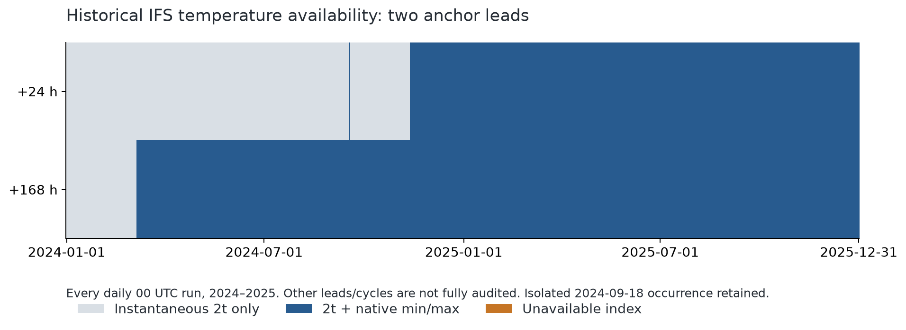
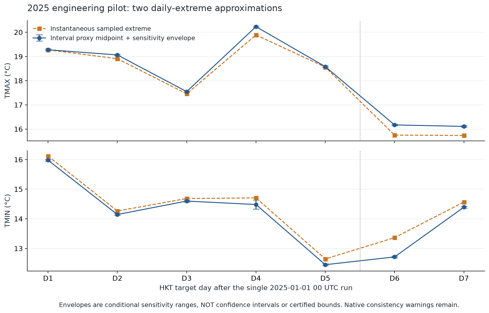
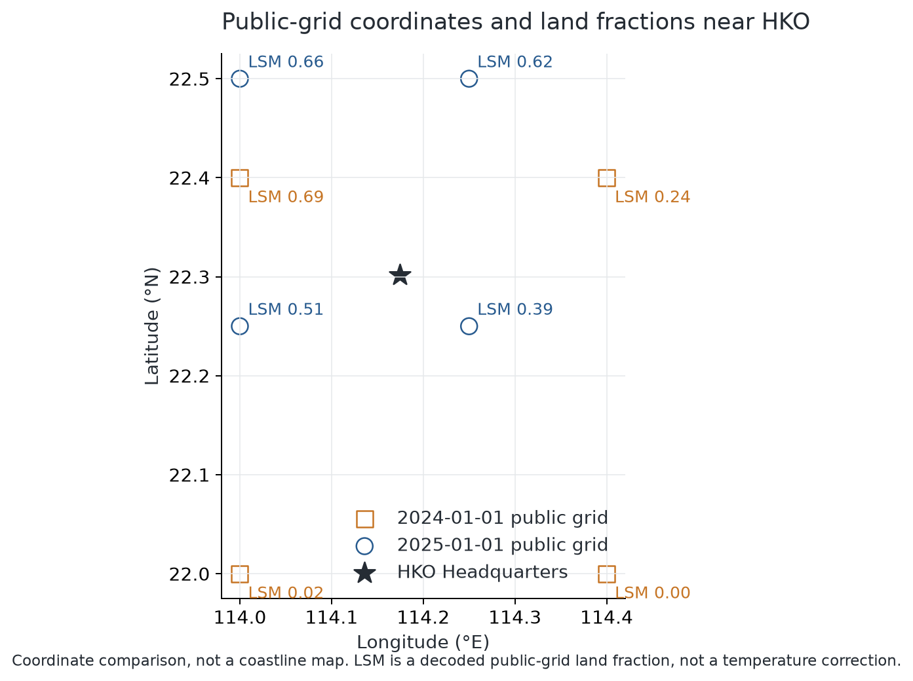
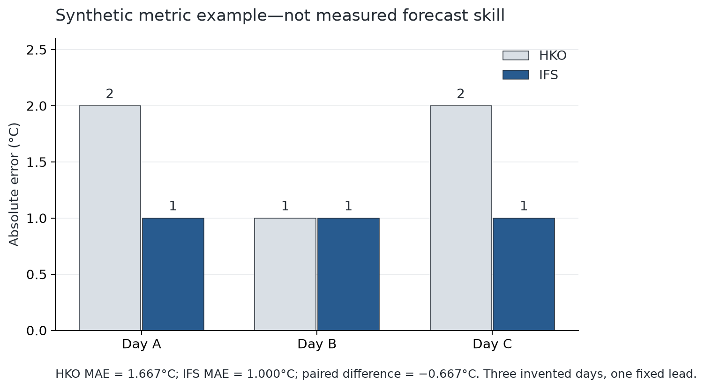

# ECMWF Open Data can support a 2025 benchmark, with explicit approximation and ingestion rules

## Executive summary

- **MARS authorization is not required for the public historical data tested here.** All **1,462** index checks succeeded: +24 and +168 hours for every daily 00 UTC run in 2024–2025. This establishes two anchor leads, not every file in the archive.
- **2025 is the cleanest candidate for the main comparison.** Native min/max fields are present at both anchors for all 365 runs. In 2024, they are present for only 50/366 runs at +24 hours and 301/366 at +168 hours; early-year data cannot silently use the same native-extrema pipeline.
- **The engineering pipeline now works end to end locally:** two complete lead sets, 226 decoded temperature fields, HKT daily reconstruction, and 28 HKO forecast/observation joins. Existing external-model columns can hold the fields after an adapter; no database change or import was made.
- **Accepted approximation does not mean exact recovery.** The 2025 interval proxy gives 14 daily-endpoint cases, but 9 native endpoint comparisons exceed the disclosed numerical allowance. Retain sensitivity ranges and source-quality flags; do not call these guaranteed bounds or confidence intervals.

This investigation was executed on **2026-11-08 HKT**. The intended task is data management and feasibility, not metric ownership or a definitive model ranking. The metric below is a proposal for the teammate. Run dates and target dates are distinguished throughout.

## 1. Access: use the public cloud archive, not the existing MARS pilot

The existing `download_ifs_pilot.py` requests the restricted historical MARS service. A valid key without archive entitlement cannot make that route work. The tested public routes are a different service:

- [AWS ECMWF bucket](https://registry.opendata.aws/ecmwf-forecasts/): anonymous HTTPS index and byte-range reads succeeded.
- Google Cloud mirror: the checked 2025 index has the **same SHA-256** as AWS; transition-date cross-checks are saved in `access_checks.json`.
- ECMWF's own rolling endpoint returned 404 for the old 2025 file tested here; this is not evidence that the cloud history is absent.
- Direct anonymous Azure access returned 409 in the probe. The official client supports public SAS-token handling, so this is not a claim that Azure requires a paid archive account.

The official [`ecmwf-opendata` client](https://github.com/ecmwf/ecmwf-opendata) is distinct from `ecmwf-api-client`. The investigation implements the documented public index-plus-byte-range protocol directly using already installed requests/ecCodes. Neither an ECMWF key nor an AWS account is used. All stored URLs are public and unsigned. Failed requests can retry/fall back, but are never converted into invented forecast values.

Current documentation adds **0.1° from 20 October 2026**, including split surface/pressure files. That is not a retrospective upgrade to the 2024–2025 inputs; the correctly named historical 0.1° surface-file probe returned 404. Always pin the historical product/resolution, rather than downloading today's default model and treating it as a historical forecast. [Current naming and release notes](https://confluence.ecmwf.int/spaces/DAC/pages/272310539/ECMWF+open+data+real-time+forecasts+from+IFS+and+AIFS)

## 2. Historical coverage is good, but the variable schema changes within 2024

| Year | Lead checked | Expected runs | Index + 2t available | Native min/max present |
| --- | --- | --- | --- | --- |
| 2024 | +24 h | 366 | 366 | 50 |
| 2024 | +168 h | 366 | 366 | 301 |
| 2025 | +24 h | 365 | 365 | 365 |
| 2025 | +168 h | 365 | 365 | 365 |

The audit checks one operational deterministic initialization per date, `class=od`, `stream=oper`, `type=fc`, at **00 UTC**. Every selected index field must match that date/time/lead identity. A public operational-forecast record is not ERA5, an analysis field or a later hindcast. The audit does not assert every intermediate lead or every other cycle is complete.

The actual contiguous regimes, rather than dates inferred from announcements, are:

| Lead | Run dates, inclusive | Resolution | Native interval extrema | Runs |
| --- | --- | --- | --- | --- |
| +24 h | 2024-01-01 to 2024-02-28 | 0p4-beta | Absent | 59 |
| +24 h | 2024-02-29 to 2024-09-17 | 0p25 | Absent | 202 |
| +24 h | 2024-09-18 to 2024-09-18 | 0p25 | Present | 1 |
| +24 h | 2024-09-19 to 2024-11-12 | 0p25 | Absent | 55 |
| +24 h | 2024-11-13 to 2025-12-31 | 0p25 | Present | 414 |
| +168 h | 2024-01-01 to 2024-02-28 | 0p4-beta | Absent | 59 |
| +168 h | 2024-02-29 to 2024-03-05 | 0p25 | Absent | 6 |
| +168 h | 2024-03-06 to 2025-12-31 | 0p25 | Present | 666 |

Consequential details:

- The selected public grid changes from 0.4° to 0.25° on **29 February 2024**. This is an output-grid change, not a claim that native model resolution equals 0.25°. [Historical announcement](https://www.ecmwf.int/en/about/media-centre/news/2024/ecmwf-releases-much-larger-open-dataset)
- +168-hour six-hour min/max become continuously present on **6 March 2024** in this audit. Shorter-lead three-hour fields do **not** become complete at the same time.
- +24-hour three-hour extrema appear once on **18 September 2024**, disappear again, then are continuously present from **13 November 2024**. The isolated occurrence's cause is not established. Google transition probes agree with the sampled AWS field lists. Do not assume the 12 November model-upgrade announcement means every 00 UTC output changed that day.
- For historical 2025-01-01, 12 UTC +168 hours is present; 06 UTC `scda` +144 is present but +168 returns 404. These individual probes demonstrate why today's stream/cycle rules must not be applied blindly to old files; they are not a full all-cycle audit.

**Implication:** a 2025 primary study is feasible with the accepted daily approximation. A full 2024–2025 study needs an explicit sampled/hybrid policy or additional archive fields. It must not backfill missing native extrema with zero, a mean temperature, reanalysis, or an unlabelled different proxy. Narrowing to 2025 is a recommendation, not an unrequested change to the team's final scope. A 2025 target-date study also needs late-December 2024 initialization buffers; those full lead sets are not downloaded here.

## 3. Real downloads, decoding and provenance—not only catalogue browsing

| Initialization | Leads to +192 h | Decoded fields | Raw field MB | Nearest point | Distance |
| --- | --- | --- | --- | --- | --- |
| 2024-01-01 00 UTC | 57 | 57 | 16.27 | 22.40°N, 114.00°E | 20.97 km |
| 2025-01-01 00 UTC | 57 | 169 | 108.77 | 22.25°N, 114.25°E | 9.71 km |

Each complete pilot contains 57 published lead times: +0 to +144 every 3 hours, then +150 to +192 every 6 hours. There is no +147-hour lead in this schedule. The 2025 run contains 57 instantaneous `2t` fields, 48 each of `mx2t3/mn2t3`, and 8 each of `mx2t6/mn2t6`. The January 2024 run contains only 57 `2t` fields.

The decoder checks GRIB2 message boundaries, parameter ID/name, forecast initialization and validity, height above ground, processing type, units, grid spacing and finite values. Temperatures are converted by **C = K − 273.15**. Download byte ranges must return an exact HTTP 206 range; a full HTTP 200 multivariable object is refused. Checksums, original units, native parameter names, intervals, coordinates and retrieval timestamps are retained.

**A real ingestion trap was detected and guarded against.** The 2025 lead-zero file contains two 224-byte min/max entries labelled +3 hours; their decoded temperature is **0 K**. They are excluded, recorded in `excluded_placeholder_fields.json`, and covered by an offline regression test. The genuine +3-hour min/max come from the correct +3-hour file. A naive concatenation could confuse the two. Similar behavior is reported in the [official client's issue tracker](https://github.com/ecmwf/ecmwf-opendata/issues/76); the local finding is supported by decoded bytes, not the issue report alone.

## 4. Daily HKT reconstruction: the approximation is usable, with honest limits

For target date D, use **D−1 16:00 UTC to D 16:00 UTC**, corresponding to 00:00–24:00 HKT. For one endpoint at a time:

- **Tmax:** the largest wholly contained interval maximum forms the lower side; the largest overlapping interval maximum forms the upper side.
- **Tmin:** the smallest overlapping interval minimum forms the lower side; the smallest wholly contained interval minimum forms the upper side.
- Add the existing pilot's numerical allowance to each relevant side: max(0.02°C, one inspected quantization step). The tested IFS packing step is 0.03125°C. This is a disclosed sensitivity allowance, not a certified error bound.
- Use the **midpoint of that endpoint's envelope** as an explicit deterministic proxy when a single value is required. Keep the endpoints, width, original samples and method label alongside it. This is not the midpoint between daily Tmin and Tmax.

**A +168-hour file alone does not cover HKT lead day 7.** For a 00 UTC run
(08:00 HKT), that target day ends at +184 hours; the first available six-hour
interval ending beyond it is +186 hours. The complete pilots therefore fetch
through +192 as a buffer. The historical +168 anchor is a variable-availability
check, not proof of complete daily coverage; production still needs all
contributing leads.

The midpoint minimizes the worst distance to the two envelope edges under absolute loss; it is **not** established as unbiased, calibrated or the most likely model extreme. That modest rationale does not turn the envelope into a probability distribution.

In the 2025 pilot, outer interval unions cover all 24 hours. Fully contained intervals cover 21 hours for D1–D5, but only **18 hours for D6–D7**, where output has become six-hourly. Durations are unions, not sums of overlapping/nested intervals. Extrema are never split by subtracting them or scaling temperature by the fraction of an interval inside the day. Current sensitivity widths are 0.0625–0.2995°C for these 14 cases, not a general forecast-uncertainty estimate.

### Native field consistency is an unresolved qualification, not hidden by the narrow ranges

Across 224 interval-versus-instantaneous endpoint checks, 47 have a positive numerical discrepancy, and **9 remain beyond the two-field allowance**. The maximum raw discrepancy is **0.1765°C**. For example, instantaneous `2t` at +123 hours exceeds the corresponding `mx2t3` value at the same public grid point.

This weakens the premise that all fields describe one perfectly consistent, already-interpolated temperature path. Its cause is **not established** here: do not attribute it solely to packing, interpolation or a model bug. An [ECMWF forum user reports analogous behavior](https://forum.ecmwf.int/t/inconsistencies-between-t2m-and-mn2t3-mn2t6-mx2t3-mx2t6-fields-after-interpolation-to-station-points/14190), but that is not an official resolution. Accordingly, our envelopes remain **conditional sensitivity ranges**, not certified bounds on the model's true daily endpoint. The accepted approximation can still support a clearly labelled retrospective study; preserve these warnings and compare approximation sensitivity rather than silently increasing padding until a check passes.

| Target date | Endpoint | Midpoint proxy °C | Sensitivity envelope °C | Inner / outer coverage h |
| --- | --- | --- | --- | --- |
| 2025-01-02 | tmax | 19.276 | 19.245–19.307 | 21 / 24 |
| 2025-01-02 | tmin | 15.977 | 15.944–16.009 | 21 / 24 |
| 2025-01-03 | tmax | 19.062 | 19.031–19.094 | 21 / 24 |
| 2025-01-03 | tmin | 14.145 | 14.114–14.176 | 21 / 24 |
| 2025-01-04 | tmax | 17.548 | 17.517–17.580 | 21 / 24 |
| 2025-01-04 | tmin | 14.599 | 14.567–14.630 | 21 / 24 |
| 2025-01-05 | tmax | 20.232 | 20.200–20.263 | 21 / 24 |
| 2025-01-05 | tmin | 14.482 | 14.332–14.632 | 21 / 24 |
| 2025-01-06 | tmax | 18.580 | 18.549–18.611 | 21 / 24 |
| 2025-01-06 | tmin | 12.452 | 12.421–12.483 | 21 / 24 |
| 2025-01-07 | tmax | 16.171 | 16.140–16.203 | 18 / 24 |
| 2025-01-07 | tmin | 12.715 | 12.683–12.746 | 18 / 24 |
| 2025-01-08 | tmax | 16.110 | 16.079–16.142 | 18 / 24 |
| 2025-01-08 | tmin | 14.393 | 14.361–14.424 | 18 / 24 |

The 2024 pilot's sampled extrema remain separate; no missing interval extrema are invented. The complete daily-case export includes the selected HKO forecast, complete HQ observation, fixed cutoff, exact window and source fingerprints. **28 joined endpoint cases are not 28 independent forecast runs:** they come from only two model initializations, and only the 2025 run has full interval reconstruction.

## 5. Geography: a coastal point matters even when coordinates match across models

HKO Headquarters is at 22.30194°N, 114.17417°E, with documented ground elevation **32 m**. The two tested grids select different nearest points, as shown above. The 2025 IFS coordinate matches the existing GFS pilot's 22.25°N, 114.25°E coordinate; matching coordinates does not prove matching model land mask or orography.

The nearest public-grid IFS land fraction is **0.6875 in 2024** and **0.3906 in 2025**. These decoded, coarsened public-grid mask values describe mixed coastal representation. They are not observed land coverage, and do not alone prove the binary classification of a native computational grid point. The 2025 surface geopotential gives a geopotential height of about **47.7 m**, versus the HQ ground elevation of 32 m. No lapse-rate or bias correction is applied. Surface geopotential is absent from the inspected January 2024 surface file, so that comparison is left unavailable rather than borrowed from 2025.

The four neighboring coordinates and temperatures are saved for a pre-specified spatial sensitivity check. Do not choose a different "best" grid point each day after observing its error. Any station calibration must be fit outside the evaluation targets and frozen. The benchmark compares a public HKO forecast product and raw IFS output at an HQ reference, not all of Hong Kong or the intrinsic ability of entire agencies. Geographic differences are a possible representativeness issue, not a demonstrated cause of this pilot's errors. [ECMWF coastal/orographic guidance](https://confluence.ecmwf.int/spaces/FUG/pages/673551774/Section+9.6.2+Coastal+island+mountain+and+ice+effects)

## 6. Database compatibility: an adapter is needed, not automatically new tables

The live `.env` database was inspected in a read-only repeatable-read transaction. Existing source tables contain **65 GFS source subsets** for the January 2024 pilot and no imported IFS model. Both HQ observation series contain all 731 requested dates, numeric and marked C. The canonical schema reference remains [DATABASE_AGENT_GUIDE.md](../../../DATABASE_AGENT_GUIDE.md); `database_check.json` is a bounded inspection receipt, not a second maintained schema document.

| Input difference | Required engineering |
| --- | --- |
| ECMWF JSON-lines `.index` versus NOAA textual `.idx` | Separate index parser and explicit requested-lead filtering; implemented for this investigation |
| Native `mx2t3/mn2t3/mx2t6/mn2t6` versus GFS labels | Preserve native short names/IDs in storage; use analysis aliases only for shared reconstruction |
| Different valid-time spacing and encoded intervals | Decode GRIB `startStep/endStep/stepType`; never infer all intervals from requested spacing |
| Kelvin versus HKO Celsius | Retain source unit/value and store converted Celsius; implemented |
| 0.4°/0.25° and coastal-grid differences | Save grid spacing, extraction method, coordinates, distance, mask/orography diagnostics |
| Public archive bytes versus existing GFS manifests | Add an IFS manifest/import adapter; do not feed these files to `manage_gfs.py import` |
| Source fingerprints versus PostgreSQL UUID keys | Deterministic UUID mapping, source/temperature FK linkage and explicit archive-root convention |
| Daily approximation versus original subdaily source | Keep original fields; create derived cases separately only after the team's specification |

The **existing two external-model tables can represent this deterministic temperature subset without new columns**, according to the inspected columns/constraints and the offline payload check. `import_payload_preview.json` contains 226 source/extract pairs with native names and valid UUIDs; these are **not inserted**. Its source grain is one downloaded single-field subset, so source count need not equal lead count. The preview's explicit `archive_root=repository_root` must be respected by any future adapter; old GFS readers assume their own downloads root.

Still needed before production import: a dedicated transactional/idempotent IFS writer, reviewed manifest/path policy, restart/failure tests, and the mandatory post-commit live refresh of `DATABASE_AGENT_GUIDE.md`. There is no write option in this investigation. Adding ensemble members, additional stations or other variables would need another grain/contract review; compatibility here does not prove those wider uses.

## 7. Timing, storage, licensing and optional variables

**Timing.** Initialization, field validity, public release, object last-modified and our later retrieval are different timestamps. The example AWS and Google index timestamps differ even for identical bytes. They are useful evidence to retain, not verified original per-file availability. This pilot keeps the existing fixed **00 UTC run / 20:00 HKT cutoff scenario**, selecting HKO only when both bulletin and RSS timestamps precede the cutoff. It does not claim that this is the latest available model run. Scheduled dissemination is not proof every required historical file arrived on time. [Historical schedule](https://confluence.ecmwf.int/pages/viewpage.action?pageId=600793086)

**Storage.** The complete 2025 pilot's selected global temperature messages occupy **108.77 MB**. Multiplying that one January sample gives approximately **39.70 GB** for one run/day for 365 days, or **79.40 GB** for two full-horizon runs/day. These are planning extrapolations, excluding initialization buffers, indexes, manifests, backups and compression/seasonal variation. The January 2024 pilot is smaller because its parameter set is incomplete, not because two years of equivalent variables are necessarily cheap. Byte ranges select global variable messages, not a Hong Kong spatial crop. Saving only station extracts greatly reduces downstream storage; retention/deletion of original global messages should be an explicit policy, not an automatic destructive step.

**Licence.** The public catalogue uses CC BY 4.0 with ECMWF terms. Retain attribution, product/version, source URLs, retrieval dates and checksums in the handoff. Free public downloading and authorized MARS archive services are distinct; open licensing alone does not establish every service is free. [ECMWF licence and access terms](https://www.ecmwf.int/en/forecasts/datasets/open-data)

**Other variables, not part of this temperature pilot.** Native `tp` is accumulated precipitation and needs correct interval de-accumulation and unit handling; it is not automatically HKO PSR. Pressure-level `r` is not near-surface RH. `2t` with `2d` can support sampled near-surface RH where both exist, but not automatically daily RH extrema. The January 2024 sample lacks `2d`; optional-variable feasibility also changes over time. AIFS and ensembles must remain separately labelled products; ERA5 must not substitute for an original forecast.

## 8. Candidate metric for the teammate: paired difference in MAE

This is a **proposal**, not a change to the team's final evaluation design. At one fixed lead, variable and reference station, and on the same eligible dates, define:

    d_i = abs(IFS_proxy_i − observed_i) − abs(HKO_i − observed_i)
    paired ΔMAE = mean(d_i)

Negative means the IFS proxy has smaller absolute error; positive means HKO has smaller absolute error. Keep Tmax and Tmin separate. Use only common matched cases, but also report each product's coverage and exclusion reasons so a common-case restriction does not hide missing difficult weather.

### Worked example: invented data, not this pilot's forecast skill

| Synthetic case | Observed Tmax | HKO forecast | IFS forecast | HKO absolute error | IFS absolute error | IFS − HKO error |
| --- | --- | --- | --- | --- | --- | --- |
| Day A | 25 | 27 | 26 | 2 | 1 | -1 |
| Day B | 28 | 27 | 29 | 1 | 1 | 0 |
| Day C | 30 | 32 | 29 | 2 | 1 | -1 |

All temperatures/errors are in °C. HKO MAE = (2+1+2)/3 = **1.667°C**; IFS MAE = (1+1+1)/3 = **1.000°C**; paired difference = (−1+0−1)/3 = **−0.667°C**. This supports the statement "IFS was closer by an average 0.667°C in these three invented matched cases," not "IFS is generally better."

**Why this works:** each difference faces the same observed weather, units remain interpretable, and absolute errors do not cancel as signed bias does. Pairing prevents one product being scored on a different mix of dates; the paired mean equals the difference in MAEs only when membership/weights match. Compared with RMSE it is less dominated by a single large error. These benefits do not repair spatial, timing or reconstruction differences by themselves.

**Respect the approximation.** If one endpoint's reconstruction envelope is [26,28]°C and the observation is 30°C, its midpoint proxy has absolute error 3°C. Under the envelope assumption its possible error spans 2–4°C. If HKO predicts 29°C (error 1°C), the paired difference is +2°C, with a conditional sensitivity range of +1 to +3°C. That sign is robust to the stated envelope, but the envelope is not certified here and is not a statistical confidence interval. If an observation lies inside a wide reconstruction range, do not automatically award error zero: that would reward ambiguity rather than accurate point prediction.

Use mean signed error as a directional diagnostic and RMSE as a large-error diagnostic if the teammate needs them. Do not use temperature-Celsius MAPE as the default, and do not apply probabilistic prediction-interval scores to these non-probabilistic reconstruction ranges. Statistical uncertainty, seasonal splits and time-block resampling remain with the teammate; the two fixed pilots cannot establish a general ranking or independent lead-time effects.

## 9. Valuable research findings and the next engineering boundary

1. **IFS is no longer categorically blocked by MARS access.** The public cloud route supplies the tested operational history anonymously.
2. **A release announcement is not a coverage guarantee.** The two extrema families have different first/stable dates, including an isolated 2024 short-lead occurrence. Sampling only one date could miss this.
3. **The daily approximation becomes structurally coarser at long lead.** D6–D7 have 18 rather than 21 hours of wholly contained interval coverage in the 2025 run; approximation sensitivity belongs in the handoff.
4. **A small envelope is not proof of accurate reconstruction.** Native endpoint inconsistencies survive the stated numerical allowance. Keep flags and seek clarification rather than silently treating precision as certainty.
5. **Coastal representativeness is measurable.** The nearest-point distance changes from 20.97 to 9.71 km and the public-grid land fraction changes materially; no causal attribution or post-hoc correction is justified from these checks alone.
6. **Schema mismatch is manageable.** The database's generic source/temperature columns are sufficient for this subset; parser, naming, interval, provenance and import contracts are the remaining work.

Recommended next engineering step: use the working 2025 path to implement the IFS import adapter and a resumable all-required-leads acquisition plan, after the team fixes target dates, cycles/cutoff and proxy policy. Include late-2024 initialization buffers. Preserve raw fields and approximation flags. If the team insists on a uniform native-extrema 2024–2025 study, ask ECMWF specifically about the missing historical three-hour fields rather than requesting unrestricted data without a narrow need. MARS access alone would still not guarantee exact HKT daily windows.

**Not done:** a full-period raw GRIB download/import, an adopted metric protocol, verified latest-available operational selection, causal explanation of source inconsistencies, or a definitive HKO/GFS/IFS ranking. These are not required to finish this initial investigation. No contact was sent to ECMWF and no paid access was purchased.

## Verification and reproducibility

The offline verifier passed **1045 scoped checks**: cached-byte hashes, nearest-one re-extraction versus saved nearest-four extraction, independent hourly-cell coverage/range/error arithmetic, and offline target-column compatibility. This does not certify the known native-field inconsistency, historical availability or forecast skill. The main acquisition receipt is `run_metadata.json`; source-quality discrepancies are in `native_crossfield_warnings.csv`.

The compact [source-quality register](source_quality_findings.csv) records each
material issue's severity, directness of evidence, downstream risk and remediation.

Scripts, commands and boundaries are in [the investigation README](../README.md). The report and static figures are rebuilt from the saved local evidence. Native GRIB/index cache files are ignored by Git but retained locally. Exact queries live in `run_investigation.py`; credentials do not appear in any result. **Database writes: none.** The canonical guide and committed schema were not changed by this investigation.

## Sources

Public archive indexes and GRIB messages are the controlling evidence for measured coverage/values. The CSV/JSON receipts retain their exact URLs and hashes. Documentation below supplies definitions and context; current documentation does not override historical file contents.

- [ECMWF Open Data product catalogue](https://www.ecmwf.int/en/forecasts/datasets/open-data): Current public products, licence, parameters and rolling-endpoint limits; not proof of historical completeness.
- [ECMWF Open Data access and file naming](https://confluence.ecmwf.int/spaces/DAC/pages/272310539/ECMWF+open+data+real-time+forecasts+from+IFS+and+AIFS): Cloud access, filename conventions and October 2026 0.1-degree changes; historical indexes take priority for 2024–2025 availability.
- [ECMWF real-time forecasts on AWS](https://registry.opendata.aws/ecmwf-forecasts/): Official public bucket and no-account access.
- [Official ecmwf-opendata client](https://github.com/ecmwf/ecmwf-opendata): Public download interface, provider selection and Azure SAS handling; distinct from MARS API client.
- [ECMWF releases a much larger open dataset, 29 February 2024](https://www.ecmwf.int/en/about/media-centre/news/2024/ecmwf-releases-much-larger-open-dataset): Historical 0.4 to 0.25 degree product expansion.
- [Historical open-data access notes and Cycle 49r1](https://confluence.ecmwf.int/plugins/viewsource/viewpagesrc.action?pageId=462547746): Historical November 2024 stream/parameter changes; release notes do not prove the first available 00 UTC run.
- [ECMWF dissemination schedule, historical page version](https://confluence.ecmwf.int/pages/viewpage.action?pageId=600793086): Demonstrates initialization/publication distinction; not a per-file historical availability receipt.
- [ECMWF coastal, island and mountain effects](https://confluence.ecmwf.int/spaces/FUG/pages/673551774/Section+9.6.2+Coastal+island+mountain+and+ice+effects): Why coastal/orographic representativeness matters; does not attribute this pilot's errors.
- [ECMWF GRIB packing and quantization explanation](https://confluence.ecmwf.int/plugins/viewsource/viewpagesrc.action?pageId=208501579): Packing changes decoded values; does not certify the investigation's chosen numerical allowance.
- [ECMWF land–sea mask definition](https://confluence.ecmwf.int/spaces/FUG/pages/673550380/Section+2A.1.3.1+Land-Sea+mask): Land fraction interpretation; open-grid interpolated fractions do not prove a native computational point's binary classification.
- [ECMWF geopotential-height conversion](https://confluence.ecmwf.int/spaces/CKB/pages/158636068/ERA5+compute+pressure+and+geopotential+on+model+levels+geopotential+height+and+geometric+height): z/9.80665 is geopotential height, not a temperature correction or exact geometric station elevation.
- [ecmwf-opendata lead-zero placeholder issue](https://github.com/ecmwf/ecmwf-opendata/issues/76): Corroborating user report; locally decoded 0 K placeholders are the evidence for this investigation's guard.
- [ECMWF forum: instantaneous and interval-extreme inconsistency](https://forum.ecmwf.int/t/inconsistencies-between-t2m-and-mn2t3-mn2t6-mx2t3-mx2t6-fields-after-interpolation-to-station-points/14190): Unresolved community report, not an ECMWF explanation or proof of the cause.
