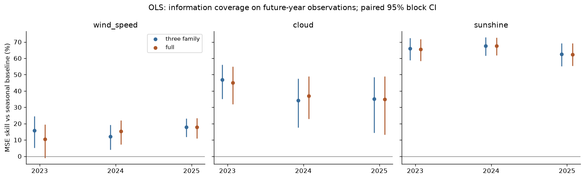
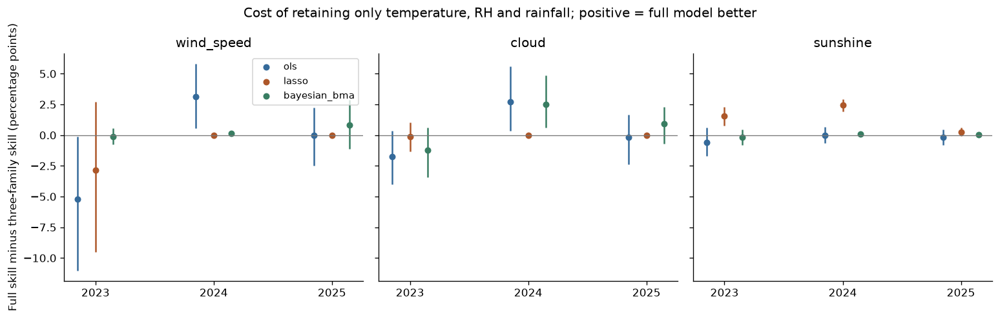

# Temperature、RH、rainfall 能涵蓋其他 weather variables 多少資訊？

**結果支持「部分資訊涵蓋」：三-family model 對 sunshine、cloud 有實質重建能力，對 wind 較有限。** 它在多數 OLS cases 接近或優於 full model，但 2024 wind／cloud 有明確的額外資訊損失。這為原有選題提供 empirical perspective，尚不足以宣稱三個 families 可代表所有 weather variables。

本輪由使用者授權 Codex 直接 fitting，並保存代碼和 executed notebook。原始 variable-selection notebook、frozen inputs、既有 forecast analyses 和 database 均未修改。

## 1. 研究問題與資料

> 控制季節後，只用 temperature、RH、rainfall，能重建 wind、cloud、sunshine 多少？相比所有 eligible families，會損失多少能力？

Inputs 固定為 HQ Tmax、Tmin、RH min、RH max、rainfall，後者使用 log1p(mm)。Outcomes 是 Airport daily mean wind speed（km/h）、HQ cloud amount（%）及 King's Park sunshine（hours）。這些是五個 public forecast families 的有限 observation proxies。

沿用先前 hash-verified frozen inputs：2022–2025，11,688 observation rows、1,461 calendar dates、1,458 common QC-valid dates。三個排除日均在 2023，沒有插補或更換 station。完整 daily-window／QC／source limits 見 [原 notebook guide](code/README.md)。

本輪是已看過前一輪結果後建立的 exploratory follow-up。2025 已用於先前 EDA，不是整個研究的 untouched test。

## 2. 比較設計

| Scope | Predictors |
|---|---|
| Seasonal baseline | Intercept、兩階 annual Fourier harmonics |
| Three-family | Seasonal controls + Tmax、Tmin、RH min、RH max、log1p(rainfall) |
| Full：wind outcome | Three-family + cloud、sunshine |
| Full：cloud 或 sunshine outcome | Three-family + wind speed；cloud、sunshine 整個 family 均排除 |

主分析為 **固定 OLS**，沒有 F-test filtering。這直接比較預先指定的兩組 inputs，避免把 significance filtering 與 scope 差異混在一起。因此 full OLS 不一定等同上一輪的 F-selected OLS。

LASSO 與 Bayesian BMA 是 method sensitivity。沿用 notebook 的 training-only residualization／scaling、40-alpha grid、三個 chronological inner folds、七 calendar days purge 和 one-SE rule；LASSO 不是 group LASSO。Bayesian 採相同 grouped g-prior subsets；兩個 scopes 共用 full-model training residuals 估計的 AR(1)，以減少 covariance fitting 差異。PIPs／predictions conditional on 此 rho；未積分 rho uncertainty。Primary g=n、inclusion prior=.5；另測 g=n/4、4n 及 prior=.25 的六種組合。

Outer expanding train／evaluation：2022→2023、2022–2023→2024、2022–2024→2025；七個 calendar days purge。Training 各 358／720／1,086 日，evaluation 各 362／366／365 日。所有 scope、method 和 scenario 使用相同完整日期。

固定 seed=20261118；Trace=.025 mm，另測 0／.05。沒有搜尋最有利的 outcome、年份或門檻。預設未指定 equivalence margin，因此不作「代表性合格／等效」判定。

## 3. 結果如何閱讀

`Skill = 1 − MSE_model / MSE_seasonal`。它表示對 seasonal-only baseline 的 MSE 改善，不是 overall variance explained，也不是 forecast accuracy。

`Skill gap = Skill_full − Skill_three_family = (MSE_three_family − MSE_full) / MSE_seasonal`。

- 正 gap：限制為三個 families 後，evaluation loss 增加。
- 負 gap：在這組已 fitting 模型的 evaluation dates，三-family model 表現較好。
- 負 gap 不證明新增 family 沒有資訊；額外 predictors 亦可能增加 estimation variance。

CI 為 1,000 draws、七 calendar-day circular block bootstrap；三-family、full、baseline 使用完全相同的 resamples。另測十四日 blocks。CI conditional on fitted models，未涵蓋 retraining／selection uncertainty；表中為逐項 CI，沒有 multiple-comparison simultaneous coverage 保證。

## 4. OLS 主結果

以下 skill 為百分比；gap 與 CI 為 **percentage points**。所有九個 three-family skills 的主設定七日 CI 下限均大於零。

| 年份 | Outcome | Three-family skill | Full skill | Full − three-family | Paired 95% CI |
|---|---|---:|---:|---:|---|
| 2023 | Wind | 15.75% | 10.55% | −5.20 pp | [−11.01, −0.14] |
| 2024 | Wind | 12.08% | 15.22% | +3.14 pp | [+0.56, +5.80] |
| 2025 | Wind | 17.90% | 17.86% | −0.04 pp | [−2.49, +2.25] |
| 2023 | Cloud | 46.80% | 45.06% | −1.74 pp | [−4.01, +0.34] |
| 2024 | Cloud | 34.21% | 36.91% | +2.69 pp | [+0.37, +5.61] |
| 2025 | Cloud | 35.17% | 34.98% | −0.19 pp | [−2.38, +1.66] |
| 2023 | Sunshine | 66.09% | 65.49% | −0.59 pp | [−1.72, +0.61] |
| 2024 | Sunshine | 67.60% | 67.58% | −0.01 pp | [−0.65, +0.68] |
| 2025 | Sunshine | 62.47% | 62.30% | −0.17 pp | [−0.79, +0.45] |

**Sunshine**：三-family OLS 在三個年份均有約 62–68% baseline-relative MSE 改善；加入 wind 沒有提高 OLS 點估計。這支持所選 variables 對日照有實質資訊涵蓋。不能由 CI 跨零宣稱兩模型等效。

**Cloud**：改善約 34–47%。2024 加入 wind 後，skill 增加 2.69 pp，七日及十四日 paired CI 均在零以上；說明所選三個 families 會漏掉一部分有用資訊。2023／2025 的 OLS gap 不明確。

**Wind**：改善約 12–18%，多數季節以外的 MSE 仍未消除。2024 加入 cloud／sunshine 額外改善 3.14 pp；2025 幾乎相同。不能因 full model 同樣弱，便把兩者接近解讀成已充分代表 wind。弱重建可能涉及 measurement、noise、線性模型限制或未包含的資訊，本輪沒有區分這些原因。

## 5. Sensitivity 與方法分歧

- **Bootstrap blocks**：2024 wind／cloud 的額外改善在十四日 blocks 仍明確，gap CI 分別 [+0.70, +5.86]、[+0.52, +5.56] pp。2023 wind 的負 gap 在十四日 CI [−11.72, +0.26] pp 跨零，不能把三-family 較佳當作 block-robust 結論。
- **Trace**：相對 .025 mm，改為 0／.05 對 primary OLS skill gap 的最大影響均小於 0.015 pp；本輪主要判讀沒有因 Trace 設定翻轉。
- **Bayesian primary**：2025 三-family／full skills：wind 16.02%／16.87%、cloud 34.02%／34.94%、sunshine 61.50%／61.51%。2024 cloud gap +2.50 pp，CI [+0.61, +4.88] pp，與 OLS 有相近方向。
- **Bayesian prior sensitivity**：2024 cloud 的 gap 點估計在六種設定為 +1.70 至 +2.60 pp；2025 sunshine 為 +0.003 至 +0.020 pp。結果仍 conditional on shared rho 和線性 Gaussian models。
- **LASSO**：2024／2025 wind 的兩個 scopes 都回到 seasonal baseline，skill=0；這不能用來證明三-family 對 wind 已足夠。2023／2024 sunshine 的 full model 額外改善 +1.58／+2.45 pp，七日 CI 分別 [+0.80, +2.30]、[+1.92, +2.90] pp。LASSO 的 scopes 各自選 alpha，差異亦可能包括 regularization／selection 的影響。

三方法不能投票成研究價值總分。主 OLS 比較、方法敏感度與 uncertainty 均須保留。

## 6. 對 Task 1 選題的意義

可採用的結論：

> 我們最初以氣象理論選擇 temperature、relative humidity 和 rainfall。後續以 2022–2025 observations 作 temporal reconstruction，顯示只用這三個 families，已能重建 cloud／sunshine 的部分季節以外資訊，對 wind 亦有較有限的能力。這提供補充的 empirical perspective，支持原有選題具有跨變數資訊涵蓋；部分年份加入其他 family 仍有改善，因此不宣稱三者完整代表所有 weather variables。

不能採用的結論包括：三者最重要、其他 variables 無研究價值、已代表完整 weather descriptions、可省略其他 agencies 的 wind／weather verification，或它們具有 causal effects。HQ rainfall 仍不是 territory-level PSR truth。

若未來需要正式「足夠接近」結論，須先依研究用途訂定 loss margin，再使用新的 temporal evidence 檢驗。若要推論對 agency comparison 的影響，須另查各 products 的 forecast errors／coverage／measurement alignment；本輪 observation covariance 並未涵蓋這些問題。

Traceability：`Task 1 scope justification → three-family information-coverage RQ → frozen daily station proxies → purged temporal reconstruction／paired loss gaps → 本結果與exports → station／model／exploratory limits → 補充選題理由，沒有importance ranking`。支援 RQ-A／RQ-D 的 scope rationale，本身不直接驗證 forecast skill 或 failure conditions。

## 7. 發布範圍與重跑

結果表及圖位於 [results/](results/)。代碼、executed notebook和重跑限制見 [code/README.md](code/README.md)。本次公開包不包含 frozen observations、source provenance files、逐日 predictions、credentials或本機路徑。完整本機run已通過15個export hashes及prediction重算；public manifest另列實際公開檔案hashes。

所有公開text files換行統一為LF，代碼的統計邏輯不變；notebook root marker改為隨附requirements file，並把已保存output的本機絕對路徑改為 `[workspace]`。已保存的settings／validation保留原run的source hashes，與經normalization的公開notebook並非相同file hash。
