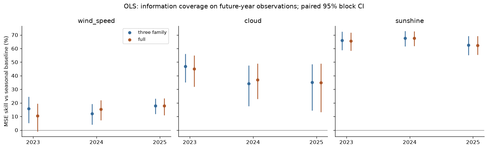
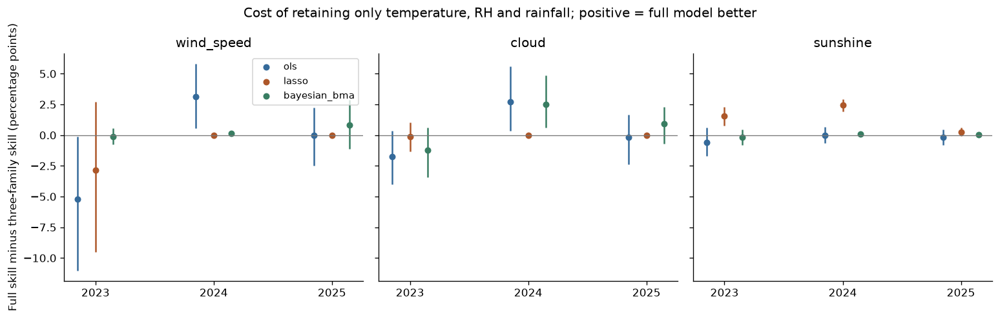

# Task 1 supplement: three-family information coverage

Can temperature, relative humidity and rainfall represent some of the information in omitted weather variables? This exploratory follow-up tests same-day observation reconstruction of Airport mean wind speed, HQ cloud amount and King's Park sunshine. It supports Task 1 scope justification; it does not rank variable importance or agencies.

Start with [中文完整結果](FINDINGS_ZH.md), the [comparison CSV](results/comparison.csv), or the [executed notebook](code/research/task1_three_family_representation.ipynb).

## Main results

Primary fixed OLS MSE skill versus a seasonal-only baseline:

| Outcome | Three-family 2023 | 2024 | 2025 | Full 2025 |
|---|---:|---:|---:|---:|
| Wind speed | 15.75% | 12.08% | 17.90% | 17.86% |
| Cloud | 46.80% | 34.21% | 35.17% | 34.98% |
| Sunshine | 66.09% | 67.60% | 62.47% | 62.30% |

These percentages are reductions in MSE relative to seasonality, not forecast accuracy or fractions of total observed variance explained. In 2024, adding the omitted family improved wind/cloud skill by **3.14/2.69 percentage points**; paired 95% seven-day block CIs were **[0.56, 5.80]/[0.37, 5.61] pp**. Both remained above zero with fourteen-day blocks. Close 2025 estimates do not establish equivalence: no acceptable-loss margin was specified.

The retained three families provide substantial reconstructible information about sunshine/cloud, and more limited information about wind. They do not fully replace the omitted families. LASSO and Bayesian sensitivities retain method disagreements, including zero LASSO wind skill in 2024/25.

## Methods and cases

- 2022–2025 frozen daily station observations; 1,458 common QC-valid dates, no imputation. Evaluation dates: 362/366/365 in 2023/24/25.
- Three-family inputs: HQ Tmax/Tmin, RH min/max and log1p(rainfall). Full wind model additionally uses cloud/sunshine; full cloud/sunshine models additionally use wind. The entire outcome family is excluded.
- Intercept plus two annual Fourier harmonics; expanding earlier-year training, seven-calendar-day purge; training-only preprocessing.
- Primary fixed OLS uses no significance filtering. LASSO uses three purged chronological inner folds, 40 alphas and one-SE selection. BMA uses grouped g-prior subsets and a shared full-training AR(1) estimate across input scopes.
- Paired 1,000-draw circular calendar-block bootstrap, blocks 7/14 days; Trace 0/.025/.05 mm and six Bayesian prior settings retained. Positive skill gap means the full model is better.

## Limits and validation

Same-day observations are unavailable at forecast issuance. This is not forecast verification, a causal analysis, social-value ranking, or evidence that agency comparisons can omit wind/weather products. Wind and weather are finite station proxies; HQ rainfall is not territory-level PSR truth. The 2025 period and three-family choice had already been explored. CIs condition on fitted models, without retraining/selection uncertainty or simultaneous multiple-comparison coverage.

The real run `20261118T065444356823Z` had 432 successful model statuses and 432 paired comparison rows. Its complete local exports passed file/ZIP hashes, prediction MSE recomputation and an independent QR prediction check. Three focused synthetic tests and a complete synthetic workflow passed. See [historical validation](results/analysis_validation.json), [publication manifest](results/publication_manifest.json), [settings](results/settings.json) and [versions](results/versions.json).

The publication contains reviewed summaries, figures, source code and notebooks. **Frozen observations and full case-level predictions are not included.** Real-data reruns require the original hash-matched inputs; [code/README.md](code/README.md) explains the setup, synthetic checks and reproduction boundary.

Traceability: Task 1 scope justification -> three-family coverage question -> frozen station proxies -> temporal reconstruction/paired loss gaps -> published results -> proxy/model/exploratory limits -> bounded empirical support for the chosen scope.
